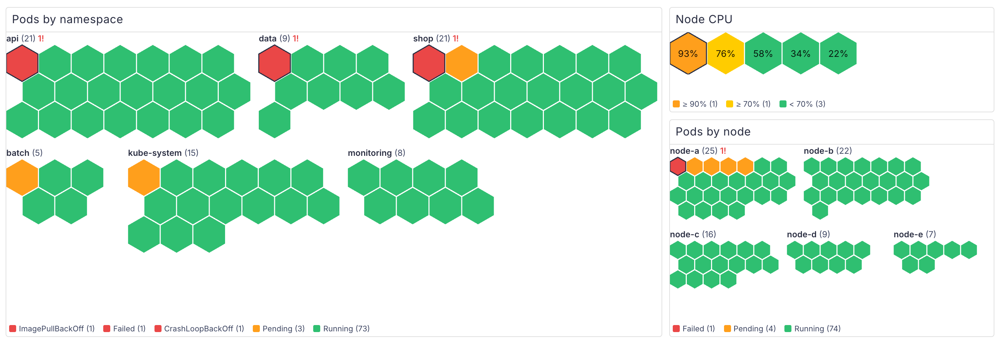
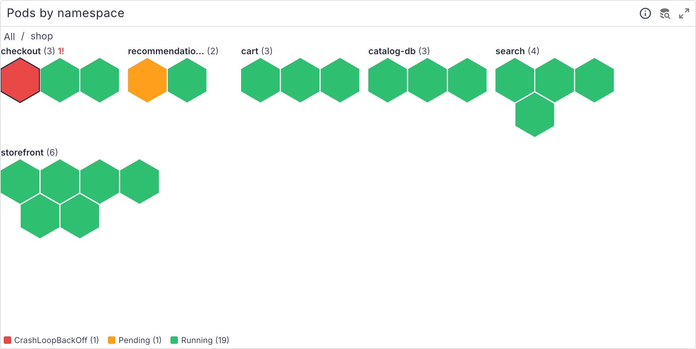

# perses-plugin-honeycomb

A [Perses](https://perses.dev) panel plugin, `HoneycombChart`, that draws one hexagon (or square) per
series, coloured by its state or value and grouped by a label. Each pod or node is a cell, grouped by
namespace or node: the one `CrashLoopBackOff` pod among three hundred is a red, outlined cell at the
top of its group, where a table would bury it on page four.

<picture>
  <source media="(prefers-color-scheme: dark)" srcset="docs/images/overview-dark.png">
  
</picture>

```promql
# Pods by namespace, coloured by phase
max by (namespace, pod, phase) (kube_pod_status_phase) == 1
```

## Supported versions

| Plugin | Perses  | Status              |
| ------ | ------- | ------------------- |
| 0.2.x  | v0.55.x | Tested with v0.55.1 |
| 0.1.x  | v0.54.x | Tested with v0.54.0 |

The plugin is built against `@perses-dev/*` 0.54 and `percli` v0.54.0. Other Perses minor versions may
work but are not tested.

## What it does

- Each series is reduced to one number with a Perses calculation (`last`, `mean`, `max`, ...) and
  becomes one cell. `nameLabel` names the cell (the series name when unset), `groupBy` groups cells
  under a title with their count and the number of problem cells.
- **Drill down**: click a group (or focus it and press Enter) to see only its cells. With
  `drillDown: [workload]`, a namespace opens into its workloads, each a group of its pods, and a
  workload opens into its pods. A breadcrumb above the grid leads back. See
  [Pods by workload](#pods-by-workload) for a query that adds a `workload` label.

  <picture>
    <source media="(prefers-color-scheme: dark)" srcset="docs/images/drill-namespace-dark.png">
    
  </picture>

- **Group layout** (`groupLayout`): `compact` (default) packs each group into a block a little wider
  than tall, side by side, so many small groups fit on one screen; a group stays at least as wide as
  its title, so a group of two or three cells is a single row. `row` lets each group run the full
  width of the panel. Each group's title is its name in bold, its cell count, and the number of
  problem cells in the error colour.
- Only series that still have a sample at the end of the time range count (`currentOnly`, on by
  default). A range query keeps a deleted pod's series, so without this a pod that is gone would
  keep its last state. Turn it off to reduce whole series over the range, like the mean CPU of every
  pod that ran.
- **Value cells** (no `stateLabel`): the colour comes from Perses thresholds (absolute or percent of
  `max`) and value mappings; mappings win. Good for CPU, memory or restarts.
- **State cells** (`stateLabel` set): the series stands for "this cell is in the state in that label"
  and counts only while its value is non-zero, the convention of kube-state-metrics
  (`kube_pod_status_phase`, `kube_pod_container_status_waiting_reason`, `kube_node_status_condition`).
  Common states get a colour by name, and value mappings (on the state text) override it:

  | Severity | Matches (case-insensitive, first match wins)                                                                       | Colour                    |
  | -------- | ------------------------------------------------------------------------------------------------------------------ | ------------------------- |
  | error    | crashloop, backoff, err, fail, oomkill, evict, unhealthy, notready, false, dead, down, lost, reject, unschedulable | theme error               |
  | warning  | pending, creat, progress, reconcil, waiting, init, degrad, warn, terminat, unknown, suspend, stall, pressure       | theme warning             |
  | ok       | running, ready, true, succeed, complete, available, healthy, up, ok, active, bound                                 | theme success             |
  | other    | anything else                                                                                                      | a stable colour per state |

- **Several series on one cell** (from several queries, say phase and waiting reason): the worst one
  wins, by severity for states and by threshold step for values, then by the higher value.
- **Sorting** (`sort`): `severity` (default) puts the worst cells first in each group and the groups
  with the most problems first; `name` and `value` sort cells and groups by name or value.
- Cells in the worst band (an error state, or a value in the highest threshold step) get an outline,
  so they stand out without relying on colour alone.
- The cell size fits the panel, from a radius of 30 px down to 5 px; past that, or with a fixed
  `cellSize`, the panel scrolls. Cells of at least 16 px radius show their value or state.
- The legend lists every colour in use with its meaning and count. The tooltip shows the cell name,
  group, value or state, and the series labels.
- Light and dark themes follow Perses.

### Pods by workload

kube-state-metrics has no `workload` label on pod series. This join adds one: the pod's controller,
through its ReplicaSet to the Deployment and through its Job to the CronJob. A Job without a CronJob,
a StatefulSet or a DaemonSet is its own workload.

```promql
label_replace(
  max by (namespace, pod, phase) (kube_pod_status_phase{phase!="Succeeded"}) == 1,
  "state", "$1", "phase", "(.*)"
)
* on (namespace, pod) group_left (workload) max by (namespace, pod, workload) (
    label_replace(kube_pod_owner{owner_kind!~"ReplicaSet|Job"}, "workload", "$1", "owner_name", "(.*)")
  or on (namespace, pod) (
    label_replace(kube_pod_owner{owner_kind="ReplicaSet"}, "replicaset", "$1", "owner_name", "(.*)")
    * on (namespace, replicaset) group_left (workload)
    label_replace(kube_replicaset_owner, "workload", "$1", "owner_name", "(.*)")
  )
  or on (namespace, pod) (
    label_replace(kube_pod_owner{owner_kind="Job"}, "job_name", "$1", "owner_name", "(.*)")
    * on (namespace, job_name) group_left (workload)
    label_replace(kube_job_owner{owner_kind="CronJob"}, "workload", "$1", "owner_name", "(.*)")
  )
  or on (namespace, pod)
    label_replace(kube_pod_owner{owner_kind="Job"}, "workload", "$1", "owner_name", "(.*)")
)
```

With `nameLabel: pod`, `groupBy: namespace`, `stateLabel: state` and `drillDown: [workload]`.

### Spec

```yaml
kind: HoneycombChart
spec:
  calculation: last # required; any Perses calculation
  nameLabel: pod # optional; series name when unset
  groupBy: namespace # optional; one group when unset
  drillDown: [workload] # optional; further grouping labels, one per click
  stateLabel: phase # optional; turns cells into state cells
  currentOnly: true # default; hide series that ended before the end of the range
  format: { unit: percent-decimal }
  thresholds: # Perses thresholds (common.#thresholds)
    mode: percent
    steps:
      - { value: 70, color: "#ed6c02" }
      - { value: 90, color: "#d32f2f" }
  mappings: [] # Perses value mappings (common.#mappings)
  shape: hexagon # hexagon | square
  groupLayout: compact # compact | row
  sort: severity # severity | name | value
  cellSize: 12 # optional; radius in px
  showValues: true
  showLegend: true
```

The CUE schema is `schemas/panels/honeycomb-chart/honeycomb-chart.cue`, with an example next to it.

## Examples

Pods by namespace, worst state first. Two queries on one panel: the phase, and the reason a
container is waiting, which is where `CrashLoopBackOff` and `ImagePullBackOff` show up. A pod with a
crash-looping container is `Running` by phase; the waiting reason is worse, so it wins.

```yaml
nameLabel: pod
groupBy: namespace
stateLabel: state
queries:
  - label_replace(max by (namespace, pod, phase) (kube_pod_status_phase) == 1, "state", "$1", "phase", "(.*)")
  - label_replace(max by (namespace, pod, reason) (kube_pod_container_status_waiting_reason) == 1, "state", "$1", "reason", "(.*)")
```

Hide finished job pods with `kube_pod_status_phase{phase!="Succeeded"}`.

Node CPU, in percent, with thresholds at 70 and 90 %:

```yaml
nameLabel: node
format: { unit: percent }
thresholds: { steps: [{ value: 70 }, { value: 90 }] }
query: 100 * (1 - avg by (node) (rate(node_cpu_seconds_total{mode="idle"}[$__rate_interval])))
```

(`node_cpu_seconds_total` carries `instance`, not `node`, unless your scrape config relabels it; join
with `kube_node_info` or use `instance` as the name label.)

Pod CPU against its limit, grouped by node:

```yaml
nameLabel: pod
groupBy: node
format: { unit: percent-decimal }
thresholds: { steps: [{ value: 0.7 }, { value: 0.9 }] }
query: |
  sum by (namespace, pod) (rate(container_cpu_usage_seconds_total{container!=""}[$__rate_interval]))
    / sum by (namespace, pod) (kube_pod_container_resource_limits{resource="cpu"})
    * on (namespace, pod) group_left (node) max by (namespace, pod, node) (kube_pod_info)
```

Node readiness as state cells. The `status` label is `true`, `false` or `unknown`, which already read
as ok, error and warning; map them to `Ready`, `NotReady` and `Unknown` for nicer text:

```yaml
nameLabel: node
stateLabel: status
query: kube_node_status_condition{condition="Ready"} == 1
```

## Try it locally

`dev/` runs Perses with the plugin, a Prometheus, and a made-up cluster of about eighty pods in six
namespaces (some crash-looping, pending or failed) to draw. The screenshots above come from it.
It needs `podman compose` or `docker compose`.

```bash
npm ci && npm run build && percli plugin build
cp Honeycomb-*.tar.gz dev/archive/
podman compose -f dev/compose.yaml up -d    # PERSES_PORT=18080 to move it off 8080
```

Open <http://localhost:8080/projects/demo/dashboards/honeycomb>. Data appears after Prometheus' first
scrapes, within a minute. `podman compose -f dev/compose.yaml down` removes it again.

## Build

```bash
npm ci
npm run build          # module-federation bundle in dist/
percli plugin build    # writes Honeycomb-<version>.tar.gz
```

See `CONTRIBUTING.md` for the checks and the release process.

## Install into Perses

Perses extracts every `*.tar.gz` in `plugin.archive_paths` into `plugin.path` at startup. Setting
`archive_paths` replaces the default, so keep the directory of bundled plugins in the list. Pick one
of the three options below and restart Perses.

### Option A: release archive

Download `Honeycomb-<version>.tar.gz` from the
[GitHub releases](https://github.com/astrona-io/perses-plugin-honeycomb/releases), put it in a directory
Perses can read, and add that directory to the config:

```bash
curl -fLO https://github.com/astrona-io/perses-plugin-honeycomb/releases/download/v0.2.0/Honeycomb-0.2.0.tar.gz
```

```yaml
plugin:
  archive_paths:
    - /etc/perses/plugins-archive # plugins bundled with Perses
    - /etc/perses/plugins-archive-extra # put Honeycomb-0.2.0.tar.gz here
```

### Option B: Kubernetes image volume

The `Containerfile` packages the archive as a plugin-only OCI image (`FROM scratch`, the archive at the
image root). Every release publishes it as `ghcr.io/astrona-io/perses-plugin-honeycomb:v<version>` for linux/amd64 and
linux/arm64, so you can use that image directly. To build and push it to your own registry instead:

```bash
percli plugin build
podman build -t ghcr.io/<owner>/perses-plugin-honeycomb:<version> .
podman push ghcr.io/<owner>/perses-plugin-honeycomb:<version>
```

Then mount it into the Perses pod as an
[image volume](https://kubernetes.io/docs/concepts/storage/volumes/#image) and add the mount path to
`archive_paths` as in option A. Image volumes need a cluster and container runtime that support them
(the `ImageVolume` feature; check your Kubernetes version and feature gates).

```yaml
volumes:
  - name: honeycomb-plugin
    image:
      reference: ghcr.io/<owner>/perses-plugin-honeycomb:<version>
      pullPolicy: IfNotPresent
containers:
  - name: perses
    volumeMounts:
      - name: honeycomb-plugin
        mountPath: /etc/perses/plugins-archive-extra
        readOnly: true
```

If the registry is private, add an `imagePullSecrets` entry to the pod as for any other image.

### Option C: custom Perses image

Copy the archive into the directory of bundled plugins. No config change is needed, because that
directory is in the default `archive_paths`:

```dockerfile
FROM persesdev/perses:v0.55.1
COPY Honeycomb-0.2.0.tar.gz /etc/perses/plugins-archive/
```

## Licences and credits

The plugin is Apache-2.0 (`LICENSE`). Third-party material and its notices are listed in `NOTICE`:
the Perses shared CUE schemas, vendored into the archive at build time (Apache-2.0).
